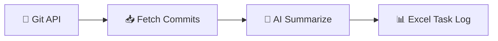

# Git Commit → Daily Task Log Generator

Automate your daily task log by reading Git commits, summarizing them with a free AI model, and outputting them in your company's Excel template format.

## How It Works

1. **You provide**: Git token + repo details + date range
2. **Tool fetches**: All your commits for that day from GitHub/GitLab
3. **AI summarizes**: Groups related commits into meaningful task descriptions
4. **Outputs Excel**: Fills your exact template format (Start time, End time, Task Logs, Priority, Assigned by, Status, Productivity %)

---

## Your Template Structure (Understood)

From your [Task log and day plan - Raveesha (1).xlsx](file:///d:/PrimeOneWork/rect_traning/gitCommited/Task%20log%20and%20day%20plan%20-%20Raveesha%20(1).xlsx), each day block follows this pattern:

| Column B | Column C | Column D | Column E | Column F | Column G | Column H |
|----------|----------|----------|----------|----------|----------|----------|
| **Date** (merged) | | | | | | |
| Start time | End time | Task Logs | | | | |
| 8.30am | | Shift started & Sign In | | | | |
| 8.30am | 8.45am | Clean the desk ∥ Checked email | | | | |
| | | Prepared the Day Plan | | | | |
| | | **Tasks completed by myself** | Priority Level | Assigned by | Task Status | Productivity (%) |
| 9.00am | 10.30am | *Actual task description...* | High/Medium/Low | *Name* | Completed/In progress | 0.0–1.0 |
| ... | ... | ... | ... | ... | ... | ... |
| Overall Productivity (Myself) | | | | | | =AVERAGE(...) |
| | | **Delegated / Assigned Task** | Team member | Assigned by | Task Status | Productivity (%) |
| Overall Productivity (Assigned) | | | | | | =AVERAGE(...) |

---

## Proposed Changes

### Tech Stack
- **Language**: Python 3 (you already have Python 3.12 installed)
- **Git API**: GitHub REST API v3 (using `requests` — no heavy SDK needed)
- **Free AI Model**: Google Gemini API (free tier — 15 RPM, 1M tokens/day) OR Groq API (free tier — very fast, Llama 3.1)
- **Excel**: `openpyxl` (already installed)
- **No web framework needed** — this is a CLI/script tool you run daily

> [!IMPORTANT]
> **You'll need to provide:**
> 1. A **GitHub Personal Access Token** (free to create at github.com → Settings → Developer settings → Personal access tokens)
> 2. A **free AI API key** — either [Google AI Studio (Gemini)](https://aistudio.google.com/apikey) or [Groq](https://console.groq.com/keys)
> 3. Your **GitHub username** and **repo names** you want to track

---

### Project Structure

All files in `d:\PrimeOneWork\rect_traning\gitCommited\`

#### [NEW] config.json
- Stores your settings: GitHub token, AI API key, GitHub username, repos to track, default values (assigned by, shift start time, break times, etc.)
- **Tokens are stored locally only** — never committed to Git

#### [NEW] git_fetcher.py
- Uses GitHub REST API to fetch commits for a given date range filtered by your username
- Extracts: commit message, timestamp, files changed, additions/deletions
- Groups commits by repository and time proximity

#### [NEW] ai_summarizer.py
- Takes raw commit data and sends it to the free AI model
- Prompt engineering to generate task descriptions matching your template style
- Example output: *"Working on Elementor Pro Training Task 02 (Setting up global colors and fonts, building the custom header, designing the hero banner...)"*
- Also estimates: priority level, task status, and productivity percentage

#### [NEW] excel_generator.py
- Uses `openpyxl` to create Excel output matching your exact template
- Includes: date header, shift start, desk/email routine, day plan prep
- Fills in task rows with AI-generated summaries
- Adds productivity formulas
- Includes delegated tasks section (empty by default)

#### [NEW] main.py
- CLI entry point: `python main.py` (defaults to today) or `python main.py --date 2026-07-13`
- Orchestrates: fetch → summarize → generate Excel
- Outputs file named like: `Task_Log_Raveesha_2026-07-13.xlsx`

#### [NEW] .gitignore
- Excludes `config.json` (contains tokens) and generated Excel files

---

## User Review Required

> [!IMPORTANT]
> **Which AI API do you prefer?** Both are free:
> - **Google Gemini** (free tier: 15 requests/min, 1M tokens/day) — Best quality summaries
> - **Groq** (free tier: 30 requests/min) — Fastest response time
> - **Both** — I can support both with a config toggle

> [!IMPORTANT]
> **Which Git platform?** 
> - **GitHub** (most common)
> - **GitLab** 
> - **Bitbucket**
> - I'll default to GitHub but can support others

> [!WARNING]
> **Your template has specific formatting** (merged cells, colors, borders). Do you want:
> - **Option A**: Generate a clean new Excel matching the structure (recommended — simpler, reliable)
> - **Option B**: Append new days directly to your existing template file (complex — risk of breaking formatting)

## Open Questions

1. **What repos do you want to track?** (e.g., `kivoragroup.com`, others?)
2. **Do you have a GitHub account or GitLab?** (I'll set up the right API)
3. **Do you want to run this manually or on a schedule?** (e.g., auto-generate at end of each workday)
4. **For "Assigned by" column** — is it always the same person (e.g., "Chathura"), or should it vary?
5. **Working hours** — should I assume 8:30am start, with tea break at 10:30-10:55 and lunch at 1:00-1:47?

## Verification Plan

### Manual Verification
1. Run the tool with a test date that has known Git commits
2. Open the generated Excel and compare structure with your original template
3. Verify AI summaries are accurate and match your writing style
4. Check that time slots, productivity ratios, and formulas are correct
